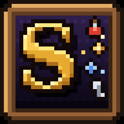

  

<h1 align="center">Sundry</h1>

<em>All Sorts, but one Addon</em>

  Many small tweaks for <strong>World of Warcraft: Forever</strong> in one addon, 
  each with its own switch, set up in the game's own options.

---

## What it does

Sundry bundles the small things you would otherwise install ten addons for. Every module and every single
feature can be switched on and off in Esc > Options > AddOns > Sundry (pages Loot & merchants, Windows, Bags, Menu &
action bars, Tooltip & unit frames, Chat & messages, Automation, Camera, sound & travel and Actions; laid out like Fray and Mundi). Comfort features start on,
everything that acts on its own (automation) starts off.

### Loot & merchants
- **Fast loot**: takes all loot at once (with auto loot; the auto loot key still works).
- Sell grey items at merchants (up to 12 per visit, with a summary and a list of items to keep).
- Repair automatically, optionally from the guild bank first.
- Alt + click on a merchant item buys a full stack, with a question above a price you choose.
- Fills in DELETE when you destroy a good item.
- Quality borders on the character window, bind on pickup confirmed without the popup when you are alone.

### Windows
- **Drag Blizzard's windows** (character, spellbook, talents, quest log, friends, merchant, bank, mail, auction
  house, professions, trainer, macros, key bindings, collections, ...), optionally only while holding a key.
- **Positions are kept** for all characters, per character or until logout. Windows you never moved stay where
  Blizzard puts them. The bag windows can be moved too, by their title bar and portrait (right click there
  opens Blizzard's bag menu).
- Ctrl + mouse wheel changes a window's size, Shift + Ctrl + right click resets it.
- Windows stay on the screen.

### Bags
- **Slots filled from the top left**: the empty cells of a partly filled row go to the bottom right.
- **Reagent bag in the bag window**, as its own area below the combined bag, opening and closing with it.
- **Bag bar** without its outer frame, in a direction you choose, fading until mouseover, and an arrow next to
  the backpack that **folds the bag slots and the key ring away**.

### Menu & action bars
- **Micro menu without its outer frame**, fading until mouseover, single buttons hidden; the others **close
  up** in a direction you choose. The buttons keep Blizzard's look.
- Key binding and macro texts on the action buttons, the action bar art, red buttons when out of range.

### Tooltip & unit frames
- At the mouse, hidden in combat (a key shows it anyway), class coloured names, the unit's target, health bar,
  item and spell IDs.
- Class coloured health bars and the combat text on the portraits.

### Chat & messages
- **Arrow keys walk through what you sent**, without Alt, and the sent messages survive a reload or logout.
- Clickable web links with a box to copy them, short channel names ("[1]"), hidden chat buttons, the input box
  above the chat, more lines per window and a window to copy the chat.
- Red error messages (not enough energy, out of range, ...) hidden in combat, always or all of them.

### Automation (all off by default, hold Shift to pause)
- **Accept and turn in quests** as two switches, with the kinds of quests to accept: normal, repeatable, low
  level, group, dungeon and raid, PvP, timed, escort and shared quests. Rewards to choose are left to you or the
  one with the highest sell value is taken.
- Skip the only option of vendors, flight masters, innkeepers, trainers and bankers.
- Decline duels and guild invites, accept group invites from friends and resurrections.
- "Take all" button in the mailbox and "Learn all" button at trainers.

### Camera, sound & travel
- **Flight time bar**: where you are flying and how long it still takes (each route is measured on its first
  flight, routes not flown yet are estimated from their length); the flight map shows the time in the tooltip of
  each destination.
- Larger camera distance, a screenshot on level up, muted sounds from a list, `/rl`.

### More
- A classic minimap button with the Sundry logo, the same frame as Fray's and Mundi's; Mundi can collect it into
  its addon button window. Entry in the addon compartment.
- Optional own settings per character.
- English and German.

## Installation

1. Download the latest release or clone this repository.
2. Place the folder in `World of Warcraft\_forever_\Interface\AddOns\` so that it is called exactly **`Sundry`**
   (it must contain `Sundry.toc`).
3. Start the game (or `/reload`) and enable *Sundry* in the addon list.

## Usage

Type `/sundry` to open the settings.

| Command | What it does |
|---|---|
| `/sundry` | Open the settings |
| `/sundry help` | List all commands |
| `/sundry windows reset` | Forget all window positions |
| `/sundry junk add \| remove <item>` | Items that are never sold |
| `/sundry mute \| unmute <sound ID>` | Muted sounds |
| `/sundry copy` | Copy the chat |
| `/sundry flights` | List the measured flight times to copy them |
| `/sundry inspect` | List the frame under the mouse and its textures |
| `/sundry reset` | Reset all settings (asks first) |
| `/rl` | Reload the UI |

## How it stays out of trouble

- **Taint.** Sundry only adds to Blizzard's code (`hooksecurefunc`, `HookScript`) and never replaces it. Windows are
  never opened or closed by Sundry, only made draggable and put back where they were saved after Blizzard placed
  them. Protected windows are not moved in combat; a pending restore runs when combat ends. Blizzard's art is hidden
  with its alpha, not with `Hide()`, so Blizzard's own updates do not bring it back.
- **Secret values.** Where the client hides names, unit data or chat text (in combat, in instances), the features
  that would read them simply leave those out.
- **Unknown client details.** Every Blizzard frame or function Sundry uses is checked first; what this client does not
  have is skipped. `/sundry inspect` lists the frame under the mouse with its textures, to find names that differ.

## Credits and licences

- Sundry is released under the [MIT License](LICENSE).
- Sundry's only own file is the logo; everything else is the game's own interface art and fonts.
- *World of Warcraft* is a trademark of Blizzard Entertainment, Inc. This project is not affiliated with or endorsed by Blizzard.

 

Disclaimer: this addon was created with the help of Claude Code (Anthropic).
